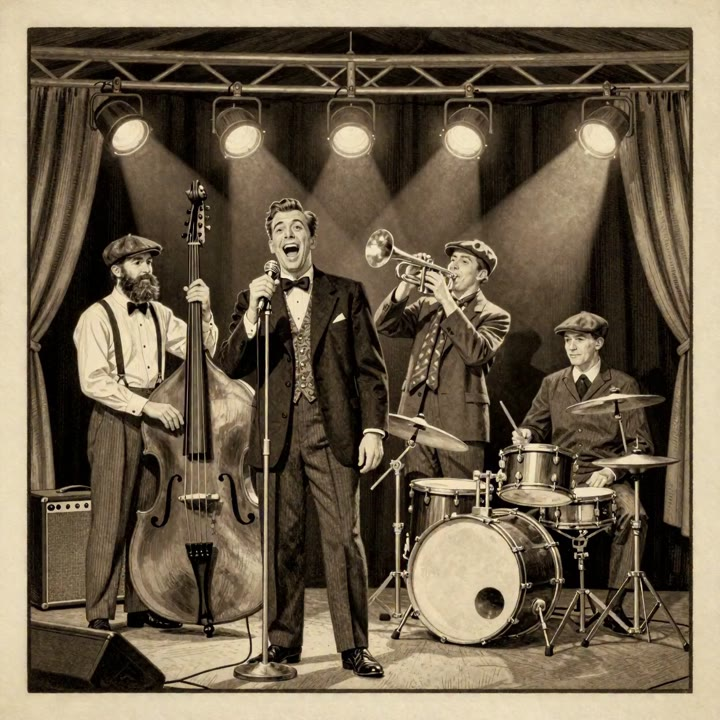
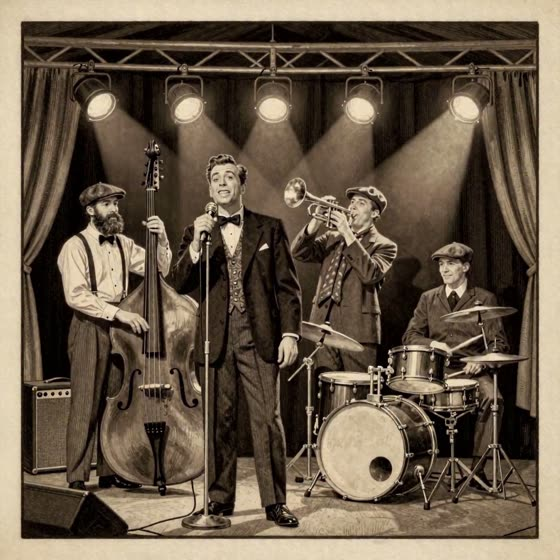
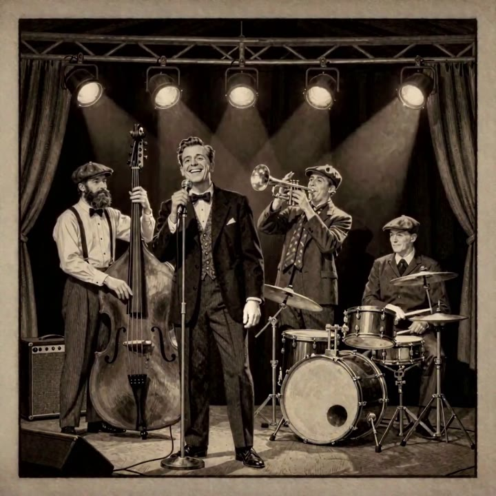
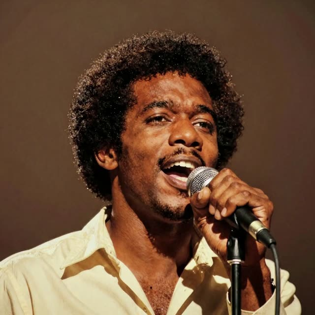
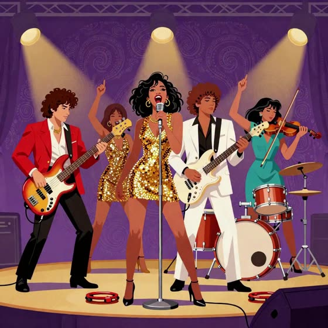
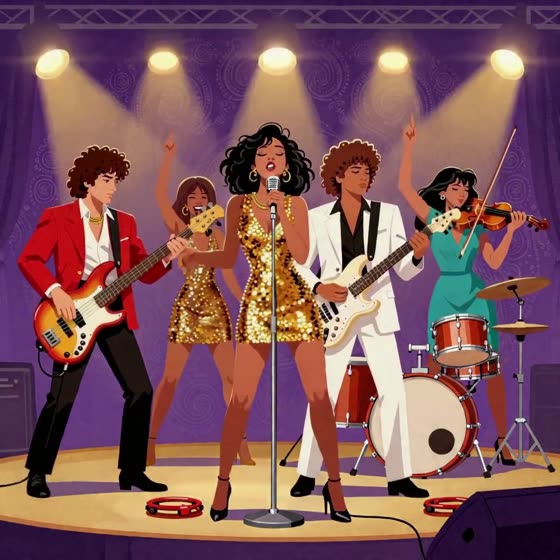
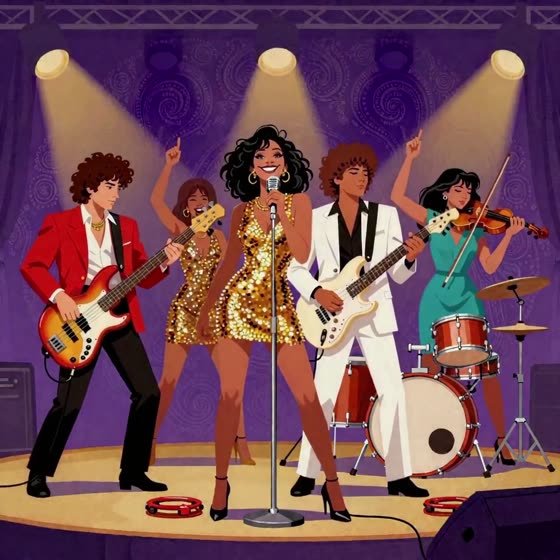

# GenKwanDo

**Any band image. Any song. A 30-second performance where every player plays their own part.**

GenKwanDo takes a cover image and a song. It finds who is in the picture, splits the song into stems, gives each performer the stem they play, and animates the image for 30 seconds with MiniMax H3 on Comfy Cloud. The original song plays underneath. Covers are square. The image you load is frame 0, rendered at 1248x1248, with everyone in it. The band, soul and funk videos in examples are 720x720 copies to keep the repo small; the MASTER v3 video is full size.

Built for the Open Source Higgsfield challenge by Ron Rauch.

**[Watch the 99-second demo](examples/GenKwanDo-demo.mp4)**

| Image in | 30 seconds out |
|---|---|
|  |   |
|  |   |
|  |   |

Watch the full pieces, with their input covers and songs, in [examples/genkwando-30s](examples/genkwando-30s/README.md).

## How it works

1. **Look.** Every person, instrument and element on the cover is identified. Exactly one singer is chosen, or none.
2. **Listen.** Demucs splits the song into vocals, drums, bass and other.
3. **Cast.** Each performer gets their own stem. People with no instrument move to the beat. A cover with no people lets its scenery carry the music.
4. **Write the prompt.** A structured prompt with actions counted from the stems for each 10-second window: kicks, snares, sung syllables, downbeats. Every element on the cover gets its own motion.
5. **Perform.** MiniMax H3 renders three 10-second windows. Window 1 starts on the cover. Each later window starts on the last frame of the one before, so 30 seconds is one continuous take of 727 frames at 24 fps.
6. **Check.** Every render is measured against its own stems before anyone sees it.

## The standards gate

| Check | Pass line |
|---|---|
| Frame 0 is the cover | image match ≥ 0.95 |
| Window joins are invisible | frame match ≥ 0.97 |
| Lips follow the voice | correlation with the vocals stem ≥ 0.40 |
| Mouth rests in silence | ≥ 0.70 |
| Each player on their own stem | p < 0.10 |
| Scene holds | match with frame 0 ≥ 0.80, brightness within 25% |

## Prompt rules learned on the way

- Every element moves, slowly and subtly: water flows, wind moves hair and grass, birds glide, clouds drift.
- Excitement comes from the players. Words like "flare" and "burst" made H3 relight whole scenes.
- Say everything positively. "No X" raises the odds of X.
- Each player moves a different body part on a different beat, so you can tell who plays what.

## Run it

1. Open [workflows/genkwando-master-v3.api.json](workflows/genkwando-master-v3.api.json) in Comfy Cloud or ComfyUI.
2. Load your cover, your song, and its vocals and drums stems (Demucs htdemucs_6s).
3. Write the three window prompts, or build them with [genkwando-engine](genkwando-engine).
4. Run. Out comes a 30-second, 727-frame video with your song underneath.

The tools in genkwando-engine are Python stdlib plus ffmpeg. Their 124 tests pass: `cd genkwando-engine && python -m pytest`.

## Where it stands

- Every piece here is square. Other shapes are untested.
- In the MASTER v3 band render the bassist jumps between frames. A re-render with calmer settings is running: seed 210664234423219, a 4-step turbo LoRA, res_multistep with kl_optimal at 8 steps, and prompts that keep heads calm and shoulders still.

## In this repository

| Folder | What it is |
|---|---|
| [examples/genkwando-30s](examples/genkwando-30s) | Square 30-second pieces with input covers, songs, stills, the workflow file, a prompt and a node-by-node walkthrough |
| [genkwando-engine](genkwando-engine) | Python tools: window planner, beat objects, prompt builder, Comfy client and graph helpers |
| [plate-doctor](plate-doctor) | Clean-plate tooling |

## Models used

| Role | Model file | Where |
|---|---|---|
| Video model | `minimax_h3_ref2va_pruned_int8_convrot.safetensors` (MiniMax H3 reference-to-video with audio; Comfy Cloud only has it as int8) | both workflows |
| Text encoder | `qwen3vl_32b_minimax_h3_bf16.safetensors` (Qwen3-VL 32B) | both workflows |
| Video VAE | `minimax_h3_video_vae_fp16.safetensors` | both workflows |
| Audio VAE | `minimax_h3_audio_vae_fp32.safetensors` | both workflows |
| Lip-motion LoRA | `minimax_h3_lms_v1.0_r64.safetensors` | MASTER v3 |
| Turbo LoRA, 8 steps | `minimax_h3_ref2v_turbo_8step_v1.1_768p_comfyui_bf16.safetensors` | MASTER v3 |
| Turbo LoRA, 4 steps | `minimax_h3_ref2v_turbo_4step_v0.1_comfyui_bf16.safetensors` | example chain workflow |
| Stem separation | Demucs `htdemucs_6s`, through Comfy's AudioStemSeparate node | stems for every song |
| Songs | ACE-Step on Comfy Cloud | generated example songs |
| Covers | Z-Image on Comfy Cloud | generated example covers |

**Running locally or on RunPod? Use the full-weight MiniMax H3 model, not the int8 one.** Comfy Cloud only offers H3 as int8, so every render here used it. On your own GPU, load the heavier full-precision H3 in the UNETLoader (node 1) and keep everything else the same.

## Stack

Comfy Cloud · MiniMax H3 reference-to-video with turbo LoRA · Qwen3-VL text encoder · Demucs htdemucs_6s · ACE-Step for generated songs · Z-Image for generated covers.

All example art and music were generated for this project.

## License

MIT. See [LICENSE](LICENSE).
