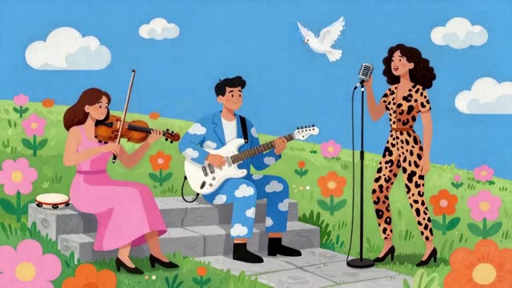
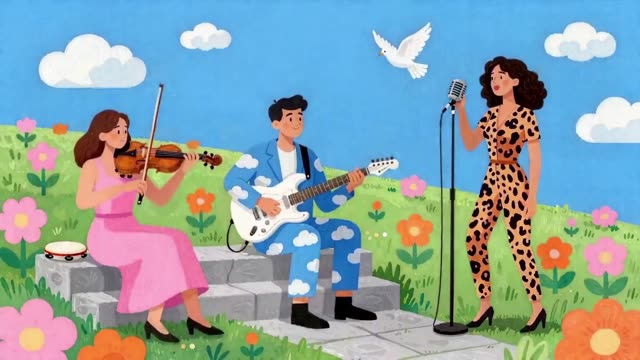
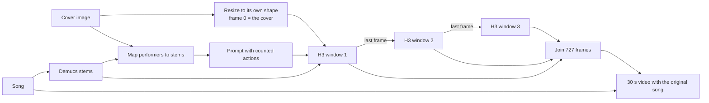

# GenKwanDo

**Any band image. Any song. A 30-second performance where every player plays their own part.**

GenKwanDo takes a cover image and a song. It finds who is in the picture, splits the song into stems, gives each performer the stem they play, and animates the image for 30 seconds with MiniMax H3 on Comfy Cloud. The original song plays underneath. The image you load is frame 0, at its own shape, with everyone in it.

Built for the Open Source Higgsfield challenge by Ron Rauch.

| Image in | 30 seconds out |
|---|---|
|  |   |
|  |   |
|  |   |

Watch the full pieces, with their input covers and songs, in [examples/genkwando-30s](examples/genkwando-30s/README.md).

## How it works

1. **Look.** Every person, instrument and element on the cover is identified. Exactly one singer is chosen, or none.
2. **Listen.** Demucs splits the song into vocals, drums, bass and other.
3. **Cast.** Each performer gets their own stem. People with no instrument move to the beat. A cover with no people lets its scenery carry the music.
4. **Write the prompt.** A structured prompt with actions counted from the stems for each 10-second window: kicks, snares, sung syllables, downbeats. Every element on the cover gets its own motion.
5. **Perform.** MiniMax H3 renders three 10-second windows. Window 1 starts on the cover. Each later window starts on the last frame of the one before, so 30 seconds is one continuous take of 727 frames at 24 fps.
6. **Check.** Every render is measured against its own stems before anyone sees it.

## The standards gate

| Check | Pass line |
|---|---|
| Frame 0 is the cover | image match ≥ 0.95 |
| Window joins are invisible | frame match ≥ 0.97 |
| Lips follow the voice | correlation with the vocals stem ≥ 0.40 |
| Mouth rests in silence | ≥ 0.70 |
| Each player on their own stem | p < 0.10 |
| Scene holds | match with frame 0 ≥ 0.80, brightness within 25% |

## Prompt rules learned on the way

- Every element moves, slowly and subtly: water flows, wind moves hair and grass, birds glide, clouds drift.
- Excitement comes from the players. Words like "flare" and "burst" made H3 relight whole scenes.
- Say everything positively. "No X" raises the odds of X.
- Each player moves a different body part on a different beat, so you can tell who plays what.

## Results so far

| Piece | Lip sync | Mouth closed in silence | Players | Joins |
|---|---|---|---|---|
| Four-man band | 0.38 | 0.75 | Drummer locks to the drums stem, p = 0.02 | 0.99 |
| Soul singer | 0.31 | 0.59 | Vocals only | 0.95 |
| Paisley trio | 0.63 | 0.80 | Light shifts mid-window | 0.98 |

A lip test on the same singer, seed and window raised lip sync from 0.37 to 0.50 at the same GPU cost by stacking a lip-motion LoRA with a newer turbo LoRA. That setting goes into the next master workflow.

## In this repository

| Folder | What it is |
|---|---|
| [examples/genkwando-30s](examples/genkwando-30s) | Three 30-second pieces with input covers, songs, stills, the workflow file, a prompt and a node-by-node walkthrough |
| [genkwando-engine](genkwando-engine) | Python tools: window planner, beat objects, prompt builder, Comfy client and graph helpers |
| [plate-doctor](plate-doctor) | Clean-plate tooling |

## Stack

Comfy Cloud · MiniMax H3 reference-to-video with turbo LoRA · Qwen3-VL text encoder · Demucs htdemucs_6s · ACE-Step for generated songs · Z-Image for generated covers.

All example art and music were generated for this project.
