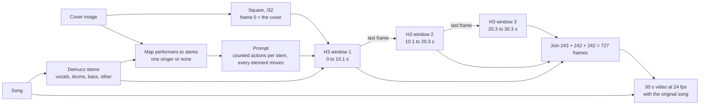

# GenKwanDo — 30-second examples

Give GenKwanDo a band image and a song. It finds who is in the picture, splits the song into stems, gives every performer their own part, and MiniMax H3 on Comfy Cloud animates the image for 30 seconds with the original song underneath. Covers are square. The image you load is frame 0, with everyone in it.

All art and music here were generated for this project (Z-Image covers, ACE-Step songs).

| Example | Cover in | Song in | 30 s out |
|---|---|---|---|
| Four-man band | [cover-four-man-band.jpg](cover-four-man-band.jpg) | [song-anthem.mp3](song-anthem.mp3) | [band-30s.mp4](band-30s.mp4) |
| Soul singer | [cover-soul-singer.jpg](cover-soul-singer.jpg) | [song-soul-anthem.mp3](song-soul-anthem.mp3) | [soul-30s.mp4](soul-30s.mp4) |
| Colour funk band | [cover-colour-funk-band.jpg](cover-colour-funk-band.jpg) | [song-funk-band.mp3](song-funk-band.mp3) | [funk-band-30s.mp4](funk-band-30s.mp4) |

The workflow that made the four-man band is [genkwando-30s-chain.api.json](genkwando-30s-chain.api.json) (Comfy API format), and its prompt is [prompt-four-man-band.txt](prompt-four-man-band.txt).

## How it flows

## Every node in the workflow

The graph is grouped into zones. Z1 input, Z4 music slices, Z5 MiniMax H3, Z7 assemble and output.

**Models (shared by all three windows)**
- `1` UNETLoader — MiniMax H3 reference-to-video model (ref2va).
- `2` LoraLoaderModelOnly — H3 turbo LoRA, so each window renders in 8 steps.
- `3` CLIPLoader — Qwen3-VL 32B text and image encoder, bf16. Reads the prompt and the cover.
- `4` VAELoader — H3 video VAE, fp16. Turns latents into frames.
- `5` VAELoader — H3 audio VAE. H3 is audio-native, so sound is part of the latent.
- `10` KSamplerSelect — res_multistep sampler.
- `11` BasicScheduler — kl_optimal, 8 steps.

**Z1 Inputs**
- `6` LoadImage — the cover. This exact image is frame 0.
- `18` ImageResizeKJv2 — the first node after the cover. Centre-crops the square cover to the square render size, divisible by 32.
- `7` LoadAudio — the original song. It is what you hear in the final video.
- `710` LoadAudio — the vocals stem, called `<Audio 1>` in the prompt.
- `720` LoadAudio — the drums stem, called `<Audio 2>` in the prompt.

**Z4 Slices, three per window**
- `110` / `210` / `310` TrimAudioDuration — vocals for windows 1, 2, 3 (0, 10.125, 20.25 s, each 10.125 s long).
- `111` / `211` / `311` TrimAudioDuration — drums for the same three windows.
- `120` / `220` / `320` TrimAudioDuration — the original song for each window's preview.
- `920` TrimAudioDuration — the original song, 0 to 30.29 s, for the final video.

**Z5 MiniMax H3, the same seven nodes per window (1xx, 2xx, 3xx)**
- `101` MiniMaxH3ReferenceToVideo — the prompt, the cover as `<Picture 1>`, the window's vocals and drums slices as `<Audio 1>` and `<Audio 2>`. 1248 × 1248, 243 frames.
- `102` MiniMaxH3AddGuide — pins frame 0. Window 1 pins the cover. Windows 2 and 3 (`202`, `302`) pin the last frame of the window before, which is how 30 seconds stay one continuous take.
- `103` RandomNoise — locked seed 210664234423221.
- `104` BasicGuider — guides the model with the prompt, the references and the guide frame.
- `105` SamplerCustomAdvanced — runs the 8 denoising steps.
- `106` VAEDecode — decodes the window's 243 frames.
- `109` / `209` GetImageRangeFromBatch — takes frame 242, the last frame, and hands it to the next window's guide.

**Z7 Assemble and output**
- `107` / `207` / `307` CreateVideo and `108` / `208` / `308` SaveVideo — a 10-second preview of each window with its slice of the song, so each part can be checked on its own.
- `901` / `902` GetImageRangeFromBatch — drop the first frame of windows 2 and 3, because it repeats the frame it was guided from.
- `910` BatchImagesNode — joins the windows: 243 + 242 + 242 = 727 frames.
- `921` CreateVideo — 727 frames at 24 fps with the original song.
- `922` SaveVideo — the 30-second video.

## Settings

| Setting | Value |
|---|---|
| Model | MiniMax H3 ref2va + turbo LoRA, 8 steps, res_multistep, kl_optimal |
| Size | 1248x1248 square |
| Windows | 3 × 243 frames at 24 fps, chained on the last frame |
| Seed | 210664234423221 |
